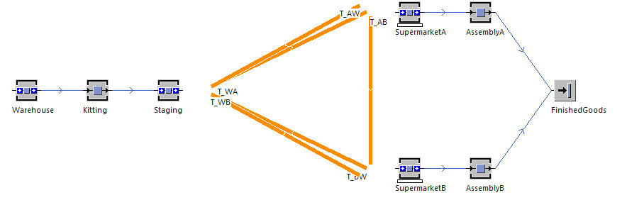
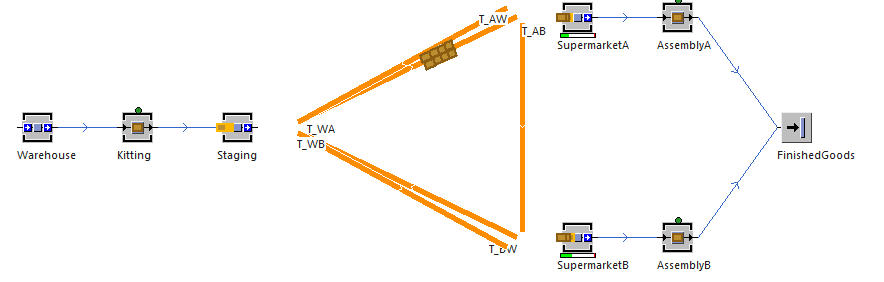
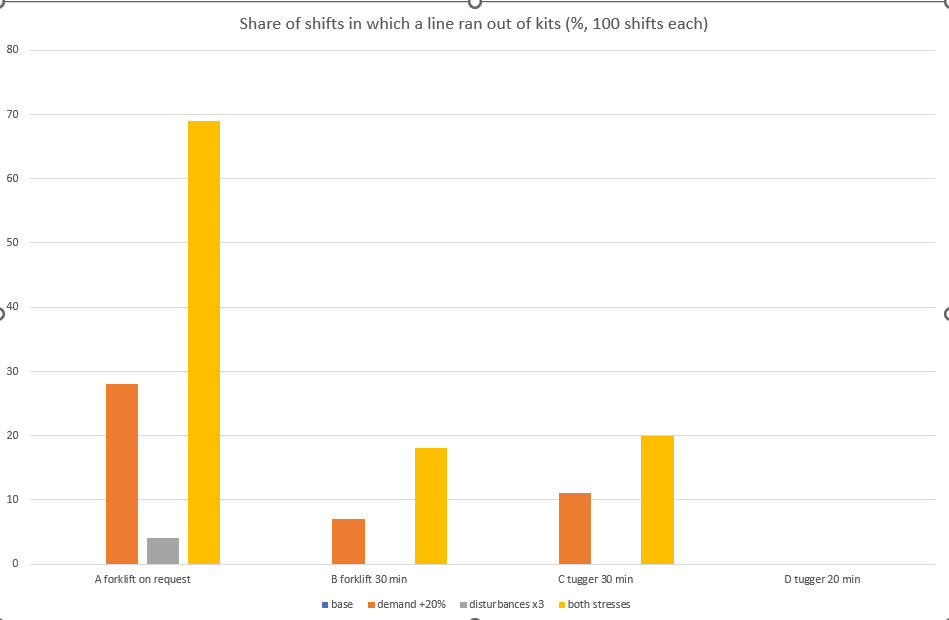

# Factory Material-Flow Simulation & Intralogistics Replenishment Optimisation — AX Drives GmbH

Discrete-event simulation in **Siemens Tecnomatix Plant Simulation 2404** of how kits move
from a central warehouse to two assembly lines, comparing four supply concepts:

| Scenario | Vehicle | Rule |
|---|---|---|
| A | Forklift (8 kits, 60 m/min) | Drives when a line orders (min/max reorder point) |
| B | Forklift | Fixed round Warehouse → Line A → Line B every 30 min |
| C | Tugger train (16 kits, 50 m/min) | Fixed milk run every 30 min |
| D | Tugger train | Fixed milk run every 20 min |

**Scope:** factory-internal material flow — kit picking, transport, line-side supermarkets and
two paced assembly lines. Suppliers, purchase orders, goods receipts, BOM/MRP and costs are
outside the scope (the warehouse never runs out). This is an intralogistics study, not an
end-to-end supply-chain model. All data are invented for a fictional company.

*Warehouse → Kitting → Staging, five tracks with the real lengths, two supermarkets, two
assembly lines.*

*Scenario A at minute 69: the forklift carries 8 kits to Line A while Line B's order is being
picked.*

## Key results

From 2,400 simulated shifts (24 experiments × 100 shifts, same random numbers for every
scenario). The figures are in [results/results.xlsx](results/results.xlsx).

- **Today's demand:** no concept ran out of kits in 100 shifts (95 % upper bound 3.7 % of
  shifts). The forklift on request needs the least: **7.7 km per shift, 42 % productive time**.
  The 30-min rounds drive about 10.8 km, the 20-min tugger 14.3 km.
- **+20 % demand and three times more vehicle disturbances:** a line ran out of kits in
  **69 % of shifts with the forklift on request** (95 % CI 59–77 %), 18 % with the 30-min
  forklift round, 20 % with the 30-min tugger, **0 % with the 20-min tugger**.
- **One tugger cannot keep a 20-minute timetable:** one loop takes 21.4 min, so almost every
  delivery is behind plan and the vehicle is occupied 96 % of the shift.
- **A local fix can backfire:** letting only Line B reorder one kit earlier made Scenario A
  worse (72 % instead of 28 % of shifts with starvation at +20 % demand), because Line A then
  waits longer for the shared forklift. Raising both reorder points helped under higher
  demand (28 → 22 %, 69 → 48 %), but not against disturbances alone (4 → 10 %).
- **Recommendation (depends on the starvation and service-level targets management sets):**
  - **A (forklift on request)** fits today's demand assumptions.
  - **B and C (30-min rounds)** are clearly more resilient but do not remove shortages under
    combined stress (18-20 % of shifts).
  - **D (20-min tugger)** had the best shortage result in every test, but one tugger cannot
    keep its nominal 20-min cycle and has almost no capacity reserve.
  - Worth testing next: a second tugger, faster loading, or a dispatch rule that serves the
    line with less stock first.

## Calculations (done by hand before building the model)

Inputs: shift 480 min; Line A 8 min/kit, Line B 12 min/kit; reorder A at 4 → order 8 kits,
B at 3 → order 6 kits; distances Warehouse–A 250 m, A–B 120 m, B–Warehouse 350 m; load 3 min
per trip, unload 2 min per stop, picking 1 min per kit.

| Calculation | Formula | Result |
|---|---|---|
| Capacity Line A / B | 480 / 8, 480 / 12 | 60 / 40 units started |
| Forklift trip to A | 3 + 2 × 250/60 + 2 | 13.33 min |
| Forklift trip to B | 3 + 2 × 350/60 + 2 | 16.67 min |
| Lead time A (forklift free) | 8 × 1 + 3 + 250/60 + 2 | 17.17 min |
| Lead time B (forklift free) | 6 × 1 + 3 + 350/60 + 2 | 16.83 min |
| Stock cover at reorder A / B | 4 × 8, 3 × 12 | 32 / 36 min |
| Worst case B (A served first) | 8 + 13.33 + 3 + 5.83 + 2 | 32.17 min (3.8 min margin) |
| Forklift busy per shift (A) | 7 × 13.33 + 6 × 16.67 | 193 min = 40 % |
| Forklift distance (A) | 7 × 500 + 6 × 700 | 7,700 m |
| Loop W → A → B → W | 250 + 120 + 350 | 720 m |
| Round time forklift / tugger | 720/60 + 3 + 2 × 2, 720/50 + 3 + 2 × 2 | 19.0 / 21.4 min |
| Kits needed per 30 min | 30/8 + 30/12 | 6.25 kits |
| 20-min tugger | 21.4 min loop > 20 min interval | cannot hold 20 min |

Details: [documentation/hand-calculations.md](documentation/hand-calculations.md); every value
is also a live Excel formula in
[assumptions-and-input-data.xlsx](documentation/assumptions-and-input-data.xlsx).

**Check:** the deterministic model reproduces these numbers in Scenario A: 13 trips,
193.33 min productive (40.3 %), 7,700 m, lead time A 17.17 min, no starvation, 59 + 39 units
completed and 1 + 1 still in assembly at 480:00 (60 + 40 started).

## How the study was done

1. **Problem, inputs and hand calculations** — problem statement, assumptions A1-A15,
   hand calculations.
2. **Model** — warehouse, kitting, staging, two supermarkets, two paced assembly lines; five
   tracks with real lengths; forklift and tugger classes; reorder logic (Scenario A) and
   order-up-to rounds with an aligned start (B-D); KPIs and four verification checks in every
   run (kits in = kits out, capacity, one vehicle, no overlapping trips).
3. **Validation** — perfect supply gives full capacity, no resupply stops the lines as
   calculated, Scenario A matches the hand calculation.
4. **Experiments** — random picking, loading, unloading and vehicle disturbances; stress tests
   for demand and disturbances; a reorder-point test; 100 shifts each with the
   ExperimentManager; results summarised in Excel with confidence intervals.

The full write-up is [documentation/report.md](documentation/report.md).

## Repository

| Folder | What is inside |
|---|---|
| `documentation/` | Problem statement, assumptions and inputs (Excel), hand calculations, report, model notes |
| `model/` | Plant Simulation model and every SimTalk method as a text file (`model/simtalk/`) |
| `results/` | `results.xlsx` (all runs, summary formulas, charts), validation, chart images, screenshots |

**Tools:** Siemens Tecnomatix Plant Simulation 2404 (Student licence), SimTalk 2, Microsoft Excel.
