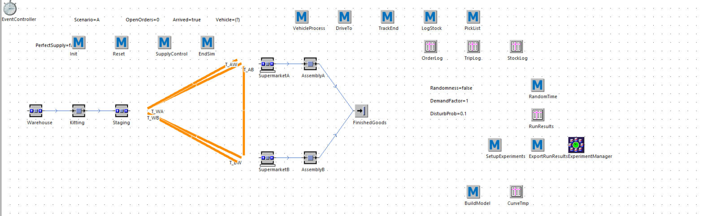

# Model notes

How the model `model/ax-drives-material-flow.spp` is built and operated. Every SimTalk method
is also stored as a text file in `model/simtalk/`.

## Objects

| Object | Purpose |
|---|---|
| Warehouse, Kitting, Staging | Pick orders are created as kits in Warehouse; Kitting picks one kit at a time (processing time Formula `RandomTime("pick")`); Staging holds picked kits |
| SupermarketA / B, AssemblyA / B, FinishedGoods | Line-side stock (12 / 9 kits) and the paced lines |
| T_WA, T_AB, T_BW, T_WB, T_AW | Tracks with the real lengths 250, 120, 350, 350, 250 m |
| `.MUs.Forklift`, `.MUs.TuggerTrain` | Vehicle classes: 8 kits at 60 m/min, 16 kits at 50 m/min, no start delay |
| Init | Clears the logs, fills the supermarkets, creates the vehicle, starts VehicleProcess |
| SupplyControl | Entrance control of the assembly stations: logs stock, Scenario A reorder check with due time |
| VehicleProcess | The whole vehicle logic (Scenario A on request, B-D fixed rounds with aligned start) |
| PickList | Order-up-to pick list for one round (B-D) with due times |
| DriveTo, TrackEnd | Put the vehicle on a track and wait for the exit control at its end |
| RandomTime | All random times; Randomness = false gives the fixed times |
| LogStock | Writes the supermarket stock after every change |
| EndSim | KPIs, the four verification checks, one row in RunResults |
| OrderLog, TripLog, StockLog | Logs of one shift |
| RunResults | One row per shift (37 columns), copied into `results/results.xlsx` |
| ExperimentManager, SetupExperiments | Experiment runs; SetupExperiments fills the experiment table |
| BuildModel, PrepareStudy, CurveTmp | Record of how objects were added by script (they do nothing now) |

## Switches (variables in the frame)

| Variable | Values |
|---|---|
| Scenario | "A", "B", "C", "D" |
| Randomness | false = fixed times, true = random times |
| DemandFactor | 1 = as given, 1.2 = both lines 20 % faster |
| DisturbProb | Probability of a 5-15 min disturbance before a trip (0.1, stress 0.3) |
| ExtraReorder | 0 = reorder points as given, 1 = Line B at 4, 2 = A at 5 and B at 4 |
| StartMode | 1 = aligned start (standard), 0 = first round at minute 0 |
| PerfectSupply | true = validation mode (a kit is replaced at once) |

The model is saved with Scenario A, Randomness false, DemandFactor 1, ExtraReorder 0,
StartMode 1.

## Running the experiments

1. In `SetupExperiments` set `study` to `"baseline"` or `"main"` and run it (F5).
2. Open the ExperimentManager, set *Observations per experiment* to 1 (baseline) or 100 (main),
   press Reset, then Start.
3. Reset the model, open `RunResults`, click a cell, Ctrl+A, Ctrl+C, and paste the rows into the
   `Runs` (or `Baseline`) sheet of `results/results.xlsx`. Writing files from SimTalk is blocked
   in this model (File > Model Settings > General > "Prohibit access to the computer"), so the
   table is copied by hand.
4. The `Summary` and `Charts` sheets recalculate by themselves.

## Plant Simulation 2404 tips found while building

- Student licence: 80 objects per model.
- Class names in 2404: `.MaterialFlow.Station` (not SingleProc), `.MUs.Part`. `ref()` is gone;
  `&Method.methCall(0)` starts a method as its own process.
- Objects can be created by script with `str_to_obj(".InformationFlow.Variable").createObject(current, x, y, "Name")`
  (also Method, DataTable, Track). The ExperimentManager can not; drag it from Toolbox > Tools.
- A new Method inherits its code: Edit > Inherit must be turned off before pasting code.
- Reserved names: `round` (and avoid `open`, `now`).
- Tracks: `TransferLengthToObject := false` plus `Length` keeps the real length; the drawn line is
  set with `getCurveSegments` / `setCurveSegments`.
- Transporter capacity is the load bay X × Y × Z (`XDim`, `YDim`); the default start delay of
  2 s per start must be set to 0.
- `z_triangle(stream, mode, min, max)`, `z_uniform(stream, a, b)`; the ExperimentManager changes
  the random-number variant per observation.
- After a run ends, objects open by double-click only after Reset.
- Starvation is 480 min − working time; Plant Simulation's waiting share leaves out the empty state.
