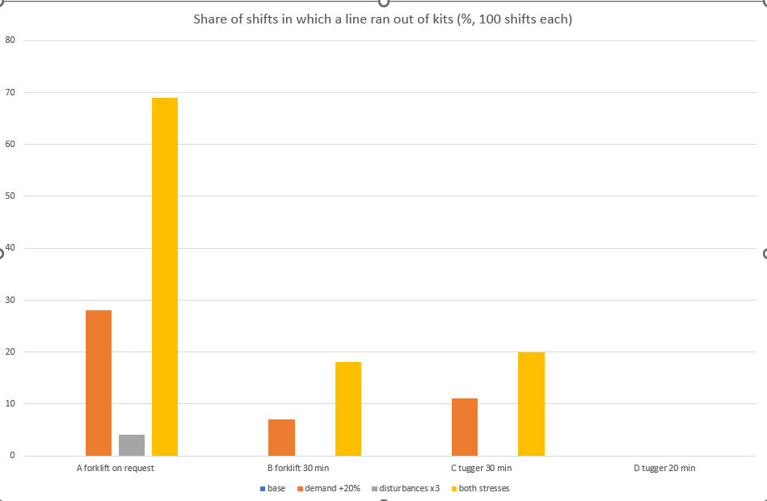
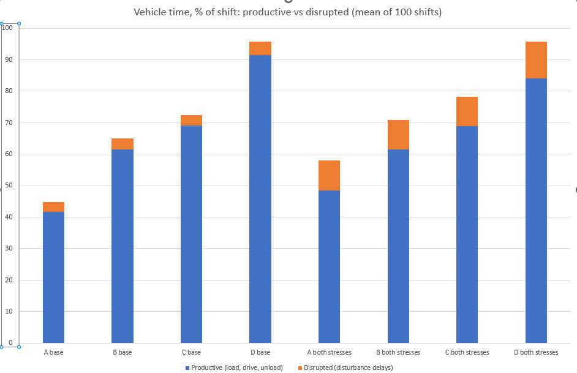
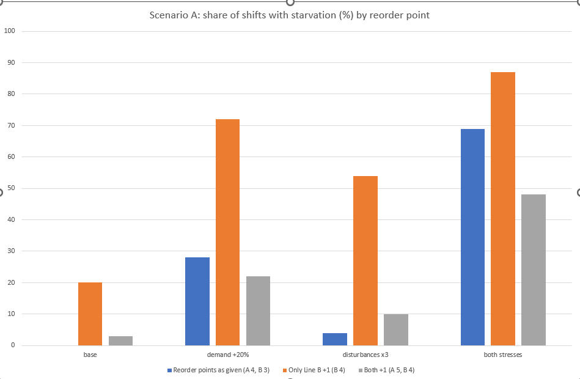

# Report: kit supply for Lines A and B at AX Drives GmbH

*Factory Material-Flow Simulation & Intralogistics Replenishment Optimisation.
Fictional company, invented data. Plant Simulation 2404 model `model/ax-drives-material-flow.spp`;
all figures are in `results/results.xlsx`.*

## 1. Question and scope

Kits are picked in the central warehouse and brought to two supermarkets beside the assembly
lines (Line A: one unit every 8 min, Line B: every 12 min). Which supply concept keeps both
lines running with the least transport effort, and how robust is it?

- **A** forklift on request (Line A reorders at 4 kits → 8 kits, Line B at 3 → 6 kits)
- **B** the same forklift on a fixed round every 30 min
- **C** tugger train (16 kits) on a fixed round every 30 min
- **D** tugger train every 20 min

The study covers factory-internal material flow only. The warehouse never runs out; suppliers,
purchase orders, goods receipts, BOM/MRP and costs are not modelled. The random disturbances
are internal vehicle interruptions, not supplier delays.

## 2. Model

- Warehouse → Kitting (picking, one picker) → Staging; two supermarkets (12 and 9 kits);
  two paced assembly stations; finished goods.
- Five tracks with the real lengths (W→A 250 m, A→B 120 m, B→W 350 m, W→B 350 m,
  A→W 250 m). Driving time follows from length / speed; it is never typed in.
- **Scenario A:** each time a kit leaves a supermarket the stock is checked; at the reorder
  point an order is created (one open order per line) and the forklift serves orders first
  come, first served.
- **Scenarios B-D:** fixed rounds W → A → B → W. Each line is filled up to its maximum minus
  stock minus kits already on the way (Line A first if capacity is short). The pick list for a
  round is made when the previous round leaves. **Aligned start:** the first pick list is made
  10 min before the first departure at minute 30 (D: 20) — see section 5.
- One method (`RandomTime`) holds every random time; with randomness off the model runs the
  fixed times of the hand calculation.

## 3. KPI definitions

| KPI | Definition |
|---|---|
| Completed output | Units finished during the 480-min shift |
| WIP at shift end | Units still in an assembly station at 480 min (completed + WIP = started) |
| Starvation | 480 min − working time of the assembly station |
| Shifts with starvation | Shifts in which either line ran out of kits at least once; 95 % Wilson interval |
| Order on time / late | Kits arrived while the line was still running / after it had run dry |
| Outstanding at shift end | Overdue if its line stands empty at 480 min, otherwise not yet due (belongs to the next shift) |
| Service level | On time / (on time + late + outstanding overdue) |
| Delivered by planned time | Delivered within the planned lead time of a free vehicle (no allowance) — a timetable measure, meaningful in deterministic runs |
| Vehicle time | Productive (load, drive, unload) + disrupted (disturbance delays) = elapsed from dispatch to return, % of the shift |

## 4. Verification and validation

| Check | Result |
|---|---|
| Perfect supply | Both lines work all 480 min; 59 + 39 completed, 1 + 1 in progress at 480:00 (unit 60 of Line A ends exactly at 480:00) |
| No resupply | Lines stop after 12 / 9 kits; starvation 80 % / 77.5 % as calculated |
| Scenario A vs hand calculation | 13 trips, 193.33 min productive, 7,700 m, lead time A 17.17 min: exact match |
| Tugger loop | 21.4 min per round in the model = hand calculation |
| Kits in = kits out, capacity, one vehicle, no overlapping trips | true in all 7 deterministic and all 2,400 random shifts |

## 5. Deterministic baseline and the start-up effect

| Run | Trips | Empty trips | Distance | Vehicle time | Orders on time | Not yet due at 480 | Delivered by planned time |
|---|---|---|---|---|---|---|---|
| A | 13 | 0 | 7,700 m | 40.3 % | 13 of 13 | 0 | 11 of 13 |
| B, start at minute 0 | 16 | 1 | 11,520 m | 63.3 % | 30 of 30 | 2 | 28 of 30 |
| B, aligned start | 15 | 0 | 10,800 m | 59.4 % | 30 of 30 | 2 | 30 of 30 |
| C, start at minute 0 | 16 | 1 | 11,520 m | 71.3 % | 30 of 30 | 2 | 28 of 30 |
| C, aligned start | 15 | 0 | 10,800 m | 66.9 % | 30 of 30 | 2 | 30 of 30 |
| D, start at minute 0 | 22 | 1 | 16,050 m | 99.6 % | 42 of 42 | 4 | 0 of 42 |
| D, aligned start | 21 | 0 | 15,400 m | 95.8 % | 43 of 43 | 3 | 2 of 43 |

All runs: 59 + 39 completed, 1 + 1 in progress, no starvation. D ends each shift with one round
still on the road; its distance includes the metres already driven on that track (210 m and
30 m).

**How distance is measured:** a track's length is added only after `DriveTo` has returned,
i.e. when the vehicle has reached the end of the track. If the shift ends while the vehicle is
on a track, the metres already driven there (`Vehicle.FrontPos`) are added as partial distance,
and the trip is counted as unfinished. Nothing is counted before it has been driven.

- **The empty round was a start-up effect.** Leaving at minute 0 with full supermarkets made
  the second pick list find nothing to deliver. With the aligned start the empty round
  disappears and the rounds keep their timetable (30 of 30 deliveries by plan). The aligned
  start is used for all random experiments.
- **The pick lists open at 480 min are not failures:** the lines still have kits; these orders
  belong to the next shift and are reported separately, not dropped.
- **Two of Scenario A's 13 deliveries were behind plan** (Line B waited behind a Line A trip),
  but both arrived before Line B ran dry.
- **D cannot keep its timetable:** with a 21.4-min loop, almost every delivery is later than
  planned and the tugger is occupied 96-100 % of the shift.

## 6. Random experiments (100 shifts each)

Picking triangular(0.75, 1, 1.5) min per kit, loading triangular(2, 3, 5) min, unloading
triangular(1.5, 2, 3) min per stop, and before a trip a 5-15 min disturbance with probability
0.1 (stress: 0.3). Stress "demand +20 %" makes both lines 20 % faster with unchanged
reorder points.

**Shifts with starvation (of 100) and 95 % interval for the share:**

| Setting | A forklift on request | B forklift 30 min | C tugger 30 min | D tugger 20 min |
|---|---|---|---|---|
| base | 0 (0-3.7 %) | 0 (0-3.7 %) | 0 (0-3.7 %) | 0 (0-3.7 %) |
| demand +20 % | 28 (20-38 %) | 7 (3-14 %) | 11 (6-19 %) | 0 (0-3.7 %) |
| disturbances x3 | 4 (2-10 %) | 0 (0-3.7 %) | 0 (0-3.7 %) | 0 (0-3.7 %) |
| both stresses | **69 (59-77 %)** | 18 (12-27 %) | 20 (13-29 %) | 0 (0-3.7 %) |

**Other KPIs, base setting (mean of 100 shifts):**

| KPI | A | B | C | D |
|---|---|---|---|---|
| Completed output (A + B) | 98 | 98 | 98 | 98 |
| Vehicle productive / disrupted / elapsed | 41.7 / 3.0 / 44.7 % | 61.6 / 3.5 / 65.0 % | 69.0 / 3.5 / 72.5 % | 91.5 / 4.3 / 95.8 % |
| Distance per shift | 7,700 m | 10,796 m | 10,790 m | 14,252 m |
| Service level | 100 % | 100 % | 100 % | 100 % |
| Lead time Line B mean / worst | 22.2 / 46.7 min | 39.5 / 56.3 min | 40.7 / 57.5 min | 34.4 / 50.5 min |
| Average stock A + B | 11.1 kits | 10.6 kits | 10.5 kits | 12.3 kits |
| Empty trips per shift | 0 | 0 | 0 | 0.23 |

Under both stresses: completed output with A falls to 117.8 of 120 on average (worst shift 116),
service level 93.3 %; B and D complete 118 in every shift (all started units except the 2 in
progress), C 117.99 on average (worst shift 117), with service levels of 99.3 %, 99.2 % and 100 %. Disrupted vehicle time rises to 9.4-11.7 % of the
shift. The confidence interval of every mean productive time is below ±0.7 percentage points.

## 7. Reorder-point test (Scenario A)

| Setting | As given (A 4, B 3) | Only Line B at 4 | Both one kit earlier (A 5, B 4) |
|---|---|---|---|
| base | 0 | 20 | 3 |
| demand +20 % | 28 | 72 | 22 |
| disturbances x3 | 4 | 54 | 10 |
| both stresses | 69 | 87 | 48 |

*Shifts with starvation (of 100).*

Raising only Line B's reorder point protected Line B but made its orders reach the shared
forklift earlier and more often ahead of Line A's, so Line A ran dry far more often. Raising
both reorder points reduced starvation when demand was higher, but slightly increased it when
only disturbances were higher: earlier orders change the order sequence at the forklift. The
reorder points of both lines have to be judged together, as one system.

## 8. Conclusions

1. For today's demand every concept keeps the lines supplied. The **forklift on request is the
   most efficient**: least driving and more than half of the forklift's time free.
2. Its weakness is the **thin safety margin** (3.8 min for Line B in the worst case). Demand
   growth plus disturbances hits it hardest (69 % of shifts with starvation).
3. **Fixed 30-min rounds** need about 40 % more driving but are clearly more robust; forklift
   (B) and tugger (C) perform about the same — their intervals overlap.
4. **The 20-min tugger** never ran out in 400 random shifts, but it cannot keep its timetable
   and the vehicle is occupied 96 % of the shift, so there is no reserve.
5. **Shared resources link the lines:** a safety margin added at one line alone can make the
   other line worse.

## 9. Recommendation

The right choice depends on targets that management still has to set: the acceptable share of
shifts with starvation and the required service level. With those open, the evidence says:

- **Scenario A (forklift on request)** is appropriate for the current demand assumptions: no
  starvation in 100 shifts, least driving, more than half of the forklift's time free.
- **Scenarios B and C (30-min rounds)** improve resilience, but they do not eliminate shortages
  under combined stress (18 % and 20 % of shifts, 95 % intervals 12-27 % and 13-29 %).
  C has twice the vehicle capacity for further demand growth.
- **Scenario D (20-min tugger)** gave the best observed shortage performance in every tested
  case (0 of 100 shifts, at most 3.7 % with 95 % confidence), but one tugger cannot keep its
  nominal 20-min cycle and the vehicle is occupied 96 % of the shift, with almost no reserve.
- **Worth testing next:** a second tugger, a faster loading process, and a dispatch rule that
  serves the line with less stock first.
- Reorder points should only be changed for both lines together, and tested first.

## 10. Limits and next steps

- The distributions are assumptions; time studies in the warehouse should replace them.
- 100 shifts per experiment: rare events are bounded (0 of 100 → at most 3.7 % with 95 %
  confidence) but not ruled out.
- Each shift starts with full supermarkets; assembly breakdowns, shift handovers and more than
  one picker are not modelled.
- Next experiments: a priority rule for the forklift queue (serve the line with less stock
  first), a second picker, a 25-min tugger interval, a different staging position.
- A component-level MRP and supplier-planning study would be a separate project; this model
  does not need to be rebuilt for it.
